# 低矮家具 AI 寻物车

> 沙发、床、柜子底下滚进去的小球、小瓶子，人很难够到。这辆小车能自己钻进去**找到它、夹起来、按原路带回来**。

本项目基于幻尔（Hiwonder）**miniAuto Pro 麦克纳姆轮小车**，加装 **ESP32-P4 AI 视觉模块**和**两自由度机械爪**，参加小学生 AI 机器人比赛。识别全部在车上的视觉模块里离线完成，**不联网、不需要电脑**。用手机连上小车自己开的 WiFi，按一下"开始寻物"就行。

<p align="center">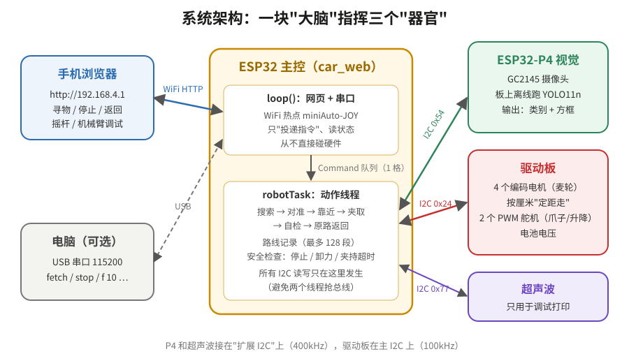</p>

---

## 目录

- [它能做什么](#它能做什么)
- [一次寻物的完整过程](#一次寻物的完整过程)
- [硬件组成](#硬件组成)
- [软件架构：两个线程分工](#软件架构两个线程分工)
- [技术原理详解](#技术原理详解)
  - [1. 看：YOLO 离线识别](#1-看yolo-离线识别)
  - [2. 找：原地转圈搜索](#2-找原地转圈搜索)
  - [3. 对准：把像素偏差换算成转角](#3-对准把像素偏差换算成转角)
  - [4. 测距：底边触发线](#4-测距底边触发线)
  - [5. 靠近：分级步长 + 防旧画面](#5-靠近分级步长--防旧画面)
  - [6. 夹取与自检](#6-夹取与自检)
  - [7. 走：麦克纳姆轮运动学](#7-走麦克纳姆轮运动学)
  - [8. 回：路线记录与倒放](#8-回路线记录与倒放)
  - [9. 安全：舵机保护与随时停车](#9-安全舵机保护与随时停车)
- [代码导读](#代码导读)
- [使用方法](#使用方法)
- [代码修改指南](#代码修改指南)（改 IP、改爪子、改升降臂、改识别物品……）
- [参数调优表](#参数调优表)
- [实测踩过的坑](#实测踩过的坑)
- [目录结构](#目录结构)

---

## 它能做什么

| 功能 | 说明 |
|---|---|
| 🔍 自动搜索 | 原地每次转 30° 停下来看，一圈没找到就随机换个位置再找（最多换 5 次） |
| 🎯 识别物品 | 车载 YOLO11n 离线识别 14 类"爪子夹得住"的东西：瓶子、球、杯子、水果、玩具熊…… |
| 📏 不用测距仪测距 | 利用"物体底边在画面中的高度"判断距离，到触发线后再走固定的 18 cm 正好落进爪子 |
| 🦾 夹取 + 自检 | 合爪抬起后后退一步看一眼：东西还躺在地上就说明没夹住，自动重试（最多 2 次） |
| 🔙 原路返回 | 记下每一步怎么走的，夹到后倒着放一遍回到起点，并补偿车走直线时的偏转 |
| 📱 手机遥控 | 网页摇杆、定距移动、机械臂调试、一键停止 / 卸力 |
| 🛡 安全保护 | 随时停车；舵机夹持超时自动卸力；电池电压过低拒绝动作 |

---

## 一次寻物的完整过程

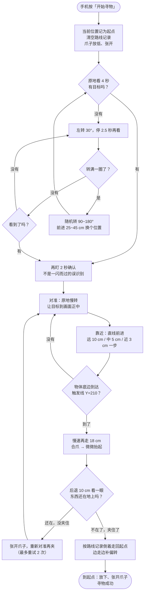

整个过程中，**手机上随时可以按"停止"或"舵机卸力"**，正在进行的任何动作都会马上中断。

---

## 硬件组成

| 部件 | 型号 / 参数 | 作用 | 通信 |
|---|---|---|---|
| 主控 | ESP32-D0WD（miniAuto Pro 原配） | 运行本项目的程序，开 WiFi 热点 | — |
| 视觉模块 | ESP32-P4 + GC2145 摄像头 | 板上离线运行 YOLO11n，输出识别框 | I2C `0x54` |
| 驱动板 | miniAuto Pro 底盘驱动板 | 4 路编码电机闭环、定距运动、2 路 PWM 舵机、电池电压 | I2C `0x24` |
| 底盘 | 4 个麦克纳姆轮，轮径 65 mm，轮距 140 mm，轴距 145 mm | 前后、横移、原地转 | — |
| 机械爪 | 2 个 PWM 舵机：升降（58°放下~132°抬起）、开合（90°闭合~160°张开） | 夹取物品 | 驱动板 PWM |
| 超声波 | 发光超声波模块 | 只在调试时打印距离 | I2C `0x77` |
| 电池 | 2 节 18650（满电约 8.3 V） | 低于 6.8 V 拒绝动作 | 驱动板读取 |

视觉模块烧录的是幻尔官方离线固件 `WonderLLM_P4_Yolo11nDetect`（COCO 80 类），本仓库不包含该固件。

---

## 软件架构：两个线程分工

ESP32 上同时跑两个任务，**分工非常严格**：

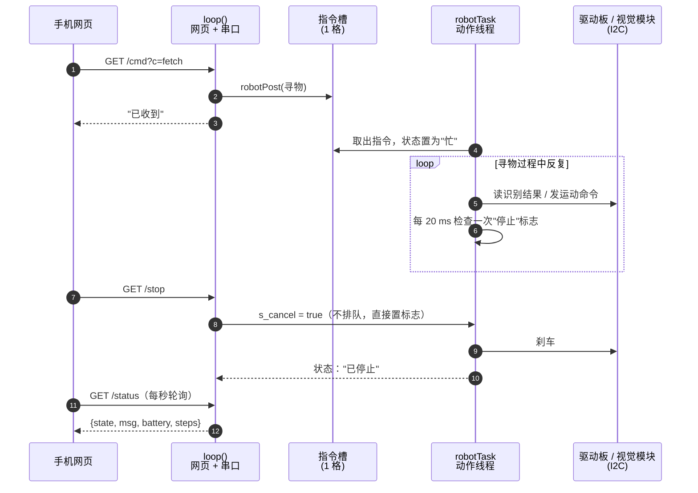

为什么这样设计：

1. **I2C 总线只有一个线程在用。** 电机、舵机、视觉、电池全挂在 I2C 上，两个线程同时读写会把数据搅乱。所以网页线程**从不碰硬件**，只往"指令槽"里放一条指令，或者置一个标志。
2. **动作中也能随时停。** 寻物一次可能要一两分钟，如果在网页处理函数里直接执行，期间网页就卡死了。放到独立线程后，网页随时响应，"停止"只是把 `s_cancel` 置成 true，动作线程里所有等待循环（每 20 ms 一次）都会检查它。
3. **指令槽只有 1 格。** 小车正忙时新指令直接拒绝（"小车正忙，请先停止或等待完成"），不会排一长串指令让车乱跑。

小车的状态在四个之间切换：

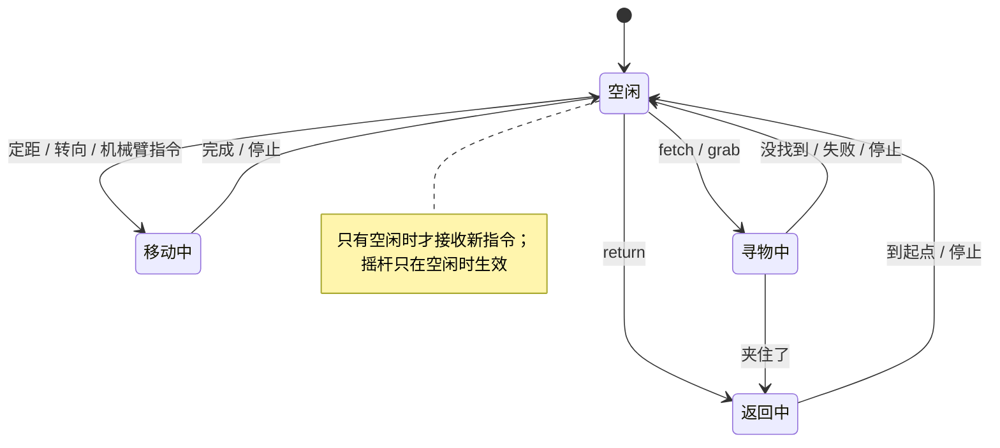

---

## 技术原理详解

### 1. 看：YOLO 离线识别

视觉模块是一块独立的 ESP32-P4 板子，自己带摄像头，自己跑神经网络。主控每次通过 I2C 问它"现在看到了什么"，它回答一个列表：每个物体的**类别编号**和**方框**（左上角 x、y，宽、高）。

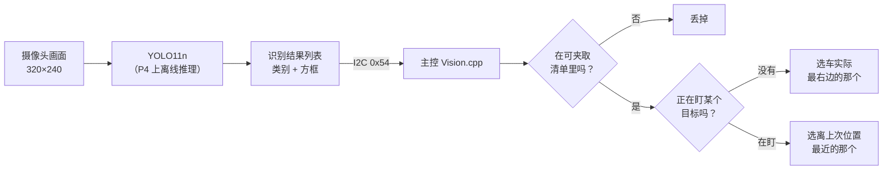

**可夹取清单。** YOLO 认得 80 类东西（人、椅子、电视……），但爪子只夹得住粗细 5 cm 以内、放在地上的小物件。代码里用一个白名单过滤（`Vision.cpp` 里的 `kGraspableClassIds`）：

| 类别 | COCO 编号 | 备注 |
|---|---|---|
| 瓶子 | 39 | 主要目标 |
| 花瓶、停车收费表、消防栓 | 75、12、10 | 细长小瓶子常被认成这些，实测后加进来 |
| 球 / 飞盘 | 32 / 29 | 小球常被认成飞盘 |
| 杯子、香蕉、苹果、橙子、胡萝卜、甜甜圈、玩具熊 | 41、46、47、49、51、54、77 | 其他小物 |
| 鸟 | 14 | 比赛用的物品实测常被认成鸟 |

书、手机、遥控器太扁（贴着地夹不起来），牙刷太细，500 ml 瓶子 6.5 cm 粗套不进爪子，这些都实测后去掉了。

**挑哪一个？** 画面里有多个目标时，选**车实际最右边**的那个，因为搜索时车是往左转的，右边的先处理，转过去后剩下的还在视野里。注意这个摄像头的画面是**左右镜像**的（车左前方的瓶子出现在画面右边），所以"车实际最右边"= 画面里 x 最小。

**盯住同一个。** 一旦开始靠近某个目标，后面每一帧都选"离上次位置最近"的那个，不会在几个物体之间来回跳。而且只认同一个类别；如果类别变了（比如瓶子这一帧被认成了花瓶），只有位置几乎没动（25 像素内）才当作同一个物体。

### 2. 找：原地转圈搜索

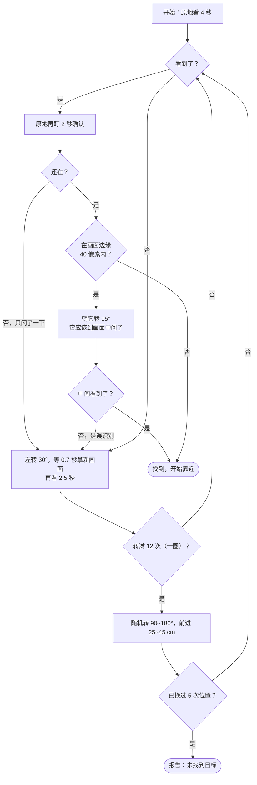

几个关键细节都是实测出来的：

- **每个方向停 2.5 秒**：P4 出一帧结果需要时间，远处的小目标也经常连续好几帧漏检。一开始只停 1.5 秒，常常"还没认出来就转走了"。
- **看到一次不算数**：偶尔会把地板花纹误认成东西，所以必须原地再盯 2 秒、再次看到才算。
- **画面边缘的目标要再确认**：边缘的识别最容易出错，先朝它转 15° 让它进到画面中间，在中间还能看到才算。

### 3. 对准：把像素偏差换算成转角

目标在画面里偏离中心多少像素，就大概要转多少度。摄像头水平视野约 63°（1.1 弧度），画面宽 320 像素：

```
每像素对应角度 ≈ 1.1 rad ÷ 320 ≈ 0.0034 rad（约 0.2°）
需要转的角度   = |偏差像素| × 0.0034 × 0.5      ← 只转一半
              再限制在 3.4° ~ 28.6° 之间
```

**为什么只转一半？** 实测用慢速（0.4 rad/s）小角度转向时，车实际会转到指令的 1.5~2 倍（电机启动和刹车时会冲过头）。只转一半，再看、再转，几次就能收敛，不会左右来回摆。

**三个"对准门槛"**（偏差在门槛以内就不转了）：

| 阶段 | 门槛 | 原因 |
|---|---|---|
| 开始靠近前 | 12 像素 | 先对正再走 |
| 直线靠近途中 | 15 像素 | 稍微宽一点，不然走一步转一下太慢 |
| 最后冲刺前 | 10 像素 | 最后 18 cm 是闭着眼走的，必须对得最正 |

**为什么不用横移纠偏？** 麦克纳姆轮在地毯上横移时，车头会跟着转，实测每次横移靠近都往右偏。所以只用"原地转 + 直线走"。

### 4. 测距：底边触发线

这是本项目最核心的技巧。小车**没有用超声波测距**（物体太小、太矮，超声波测不准），而是只用摄像头判断距离。

<p align="center">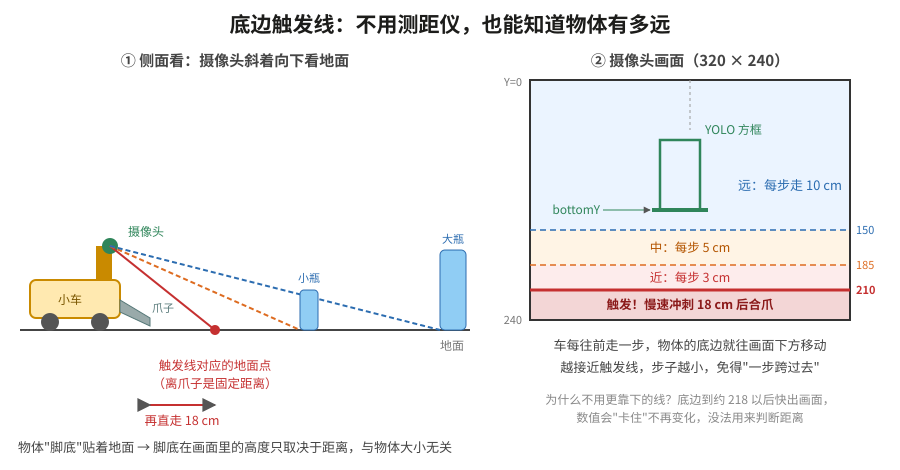</p>

**原理**：摄像头固定在车上，斜着向下看地面。地面上每一个点，在画面里的高度（Y 坐标）是固定的：越近的地面点，在画面里越靠下。物体是**放在地上**的，它的底边（"脚底"）就贴着地面，所以：

> **物体底边在画面中的 Y 坐标，只取决于它离车多远，和物体是大是小、是高是矮都没有关系。**

于是只要选一条"触发线"（Y = 210），物体底边一到达这条线，就说明物体正好在车前某个固定距离。从这里再直线走 **18 cm**，物体就正好落进两片爪子中间。这个距离是实车反复测出来的：最早用 19 cm，实测贴得太近会把物品撞倒；改 17 cm 又稍远，最后定为 18 cm。

这比"看方框大小判断距离"可靠得多：大瓶子和小瓶子在同一距离时方框大小差很多，但底边的位置一样。

**为什么不把触发线设得更靠下（更近）？** 底边到 Y≈218 以后物体就快出画面了，YOLO 给出的底边数值会"卡住"不再变化，没法再用来判断距离。

**冲刺前已经越过触发线怎么办？** 比如物体本来就很近，或者夹取失败后重试。"再走 18 cm"只在"刚刚跨过触发线"时才准，所以代码会先后退 10 cm（最多 3 次），把物体退回到线外，再正常小步靠近。

### 5. 靠近：分级步长 + 防旧画面

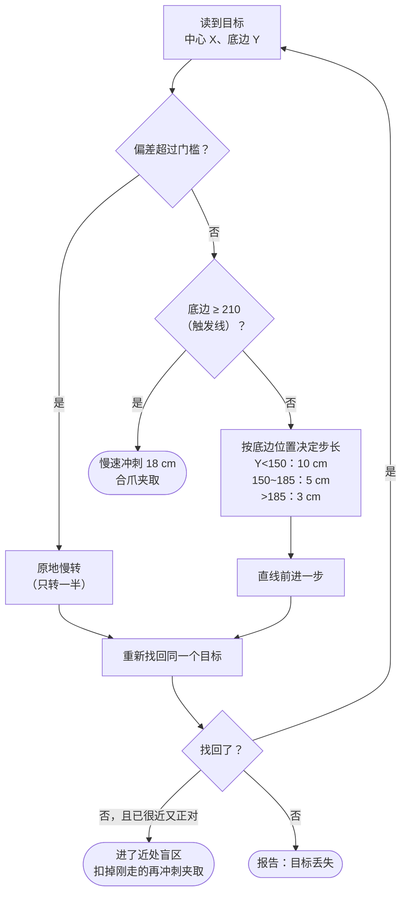

**跟着走一遍**：下面是一次靠近过程的示意（数字为示例，格式和串口打印的 `[靠近 n]` 日志一致；画面中心 X=160）：

| 步 | 看到的目标 | 判断 | 动作 |
|---:|---|---|---|
| 1 | 中心 X=196，偏差 +36，底边 Y=118 | 偏差超过 12 像素，还没对准 | 慢速转约 3.5°（偏差对应角度的一半） |
| 2 | X=171，偏差 +11，Y=119 | 已对准；底边 < 150，还远 | 前进 10 cm |
| 3 | X=175，偏差 +15，Y=141 | 途中门槛是 15，没超过；底边 < 150 | 再前进 10 cm |
| 4 | X=183，偏差 +23，Y=164 | 走着走着车头偏了，超过 15 | 原地小转纠偏 |
| 5 | X=166，偏差 +6，Y=165 | 已对准；底边在 150~185 | 前进 5 cm |
| 6 | X=168，Y=187 | 底边已过 185 | 前进 3 cm |
| 7 | X=165，Y=198 | 还没到 210 | 前进 3 cm |
| 8 | X=163，Y=211 | 底边到达触发线，偏差在 10 以内 | 爪子放低张开，慢速冲刺 18 cm，合爪抬起 |

可以看到车是"看一眼、走一步"交替进行的，每走一步都重新看一次，所以中途车头歪了也能及时纠正。越接近目标步子越小，确保正好在触发线附近停下来判断。

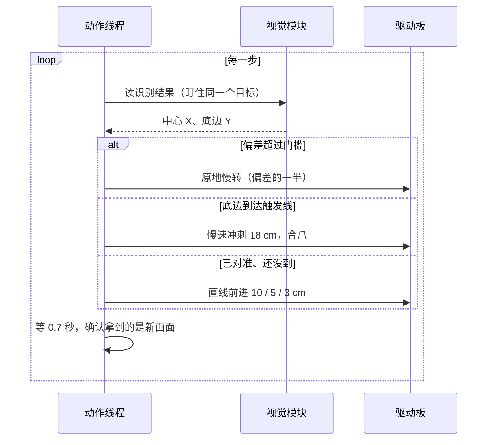

**分级步长**：远处一步走 10 cm 效率高；越靠近触发线步子越小，否则可能一步就跨过触发线（实测底边 Y=163 时走 10 cm，直接跳到了 219，冲刺距离就算错了）。

**防"旧画面"**：这是调试中最隐蔽的问题。车刚动完马上去读识别结果，读到的经常是**动之前**缓存的那一帧（实测转了 10° 后读到的 X 从 262 变成 263，几乎没动）。用旧画面做决策，就会"以为没转到位再多转一次"或者"以为还没走近再多走一步"。代码里的对策：

1. 动完先等 0.7 秒，再丢掉第一帧；
2. 如果读到的结果和动作之前几乎一样（位置、宽度都差不到 4 像素），再多等最多 1.5 秒拿新画面；
3. 前进了 5 cm 以上，底边却没有往下移至少 5 像素，也当成旧画面再等一等。

**底边只增不减**：车只往前走，物体只会越来越近，底边只会越来越往下。偶尔 YOLO 只认出物体上半截，底边会突然变小（实测 198 跳回 137，结果又多走了 10 cm），所以代码里底边取"到过的最大值"。

**丢了怎么找回来**：

- 刚转完就丢了 → 可能转过头了，往回转一半再看，还没有就再往回转一整份；
- 直线走完丢了 → 近处识别经常一半帧漏检（实测正前方的瓶子 18 帧只认出 8 帧），先多盯 2.5 秒，还不行就退回刚才能看到的位置；
- 已经很近、又正对着、突然看不见 → 多半是物体底边已经出了画面（近处盲区），直接按剩余距离冲刺夹取。

### 6. 夹取与自检

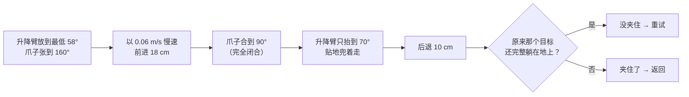

- **最后冲刺放慢到 0.06 m/s**：万一碰到物体，冲击小，车头不容易被别歪。
- **爪子合到 90°（完全闭合）**：官方例程用 102°，抬起来东西会掉。
- **只抬到 70°**：舵机长时间受力会慢慢泄力，抬太高东西会掉下来，贴着地面"兜着走"最稳。
- **自检的思路很巧妙**：夹住的东西会跟着车走，紧贴车头，在画面里会被下沿截掉；**没夹住的东西还躺在原地**，车后退 10 cm 后，它会重新**完整地**出现在车前地上。所以判断条件是：原来那个位置附近（40 像素内）有个目标，底边在 170~236 之间，而且方框没贴着画面边缘。
- 视觉模块读取失败时不会瞎猜，会报告"未确认是否夹住"。爪子坏了的时候可以用串口 `check off` 关掉自检。

### 7. 走：麦克纳姆轮运动学

<p align="center">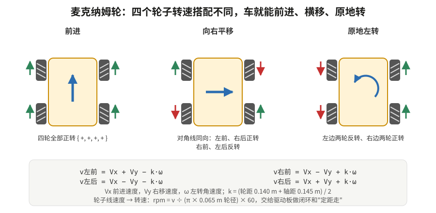</p>

麦克纳姆轮的轮子边缘有一圈斜 45° 的小滚子，每个轮子转动时会产生一个斜方向的推力。四个轮子推力组合起来，就能让车往任何方向走，或者原地转。

`Mecanum.cpp` 把"车要以多快的速度往哪个方向走、转多快"换算成四个轮子各自的转速，再交给驱动板。驱动板有编码器，能精确控制转速，还能**按距离走**：给它"以这个转速走 30 cm"，它数着编码器脉冲走到了就停。本项目里所有位移都用这种"定距走"，所以能精确记录走了多远。

原地转多少度，也换算成"轮子要走多长的弧"再定距走：

```
弧长 = k × 转角(弧度) × (180 / 190)
```

最后那个 `180/190` 是实测校准系数：命令转 180° 实际转了约 190°。

### 8. 回：路线记录与倒放

小车没有 GPS，也没有地图。它用最朴素的办法回家：**记住自己是怎么走过来的，然后倒着走一遍**。

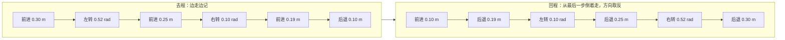

实现上有几个要点：

- **同类相邻的动作合并**：连续前进 10 cm、5 cm、3 cm 合并成一条"前进 18 cm"，路线表最多 128 条，正常寻物绰绰有余。满了会直接拒绝继续动，不会出现"走了却记不下、回不去"。
- **被打断的动作按时间估算**：比如前进 30 cm 走到一半按了停止，按"已经跑了多少秒 × 速度"估算走了多远，只记这么多。
- **长路段拆开走**：合并后可能有一段"后退 90 cm"，一次走完要 9 秒，会超过 8 秒的运动超时。所以回程每次最多走 30 cm、转 90°，走完一块就从记录里扣掉一块；中途被打断时，剩下的还留在记录里，可以再按"返回起点"接着走。
- **偏转补偿**：这辆车走直线时车头会慢慢顺时针偏（实测直走 29 cm 偏约 4.3°，即每厘米 0.0026 rad）。去程时有摄像头盯着目标会自己纠正，但回程是倒着走、看不到路的，偏差会越攒越多。所以回程中每后退一段，就按"走过的距离 × 偏转率"估算攒了多少偏转，攒够 3.4° 就原地往回补一下，最后剩下超过 2° 的也补上。
- **摇杆不计入路线**：摇杆是调试用的，走的距离不精确，所以不记录。定距按钮和寻物过程中的所有动作都记录。

### 9. 安全：舵机保护与随时停车

这部分是血的教训换来的：开发过程中曾经因为绕过了舵机的防堵转保护，让爪子舵机一直顶着用力，**舵机冒烟烧坏了**。之后加了层层保护：

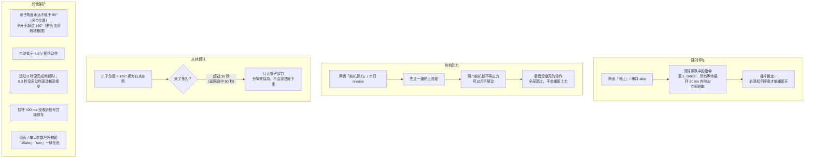

---

## 代码导读

主程序在 [`car_web/`](car_web/) 目录，一共约 5800 行，其中约 3300 行是幻尔官方提供的底层驱动，**项目自己写的核心逻辑约 1500 行**。

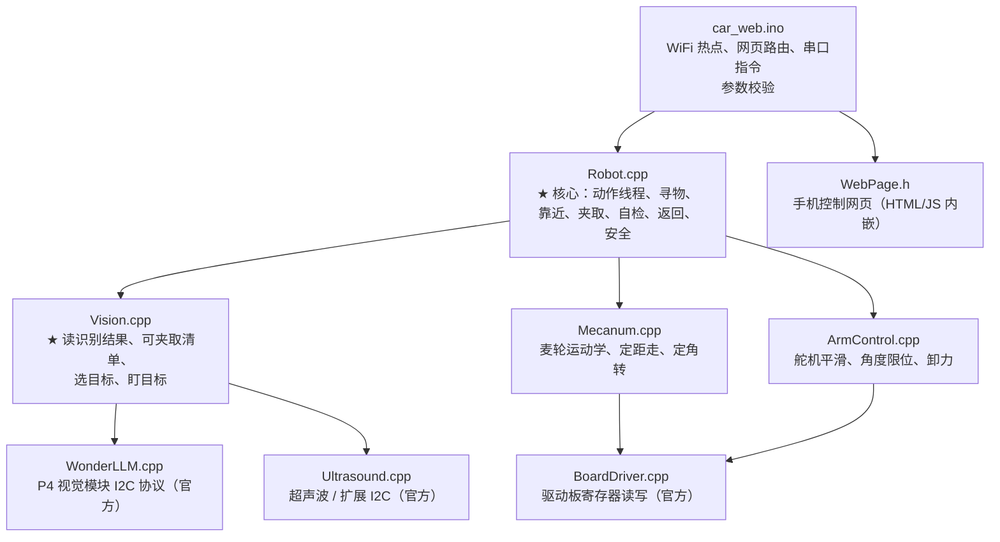

| 文件 | 行数 | 来源 | 内容 |
|---|---:|---|---|
| `car_web.ino` | 180 | 自写 | 入口：开热点、注册网页接口（`/cmd` `/stop` `/joy` `/status`）、解析串口指令 |
| `Robot.cpp` / `.h` | 940 | 自写 | **核心**。动作线程 `robotTask`；寻物 `runFetch` → 搜索 `searchTarget` → 靠近 `approachAndGrab` → 自检 `checkGrab` → 返回 `returnToStart` |
| `Vision.cpp` / `.h` | 270 | 自写 | 调用 WonderLLM 读识别结果，用白名单过滤、按规则挑目标；也支持颜色识别模式（`kVisionUseColor`） |
| `WebPage.h` | 107 | 自写 | 手机网页，自动适配深色模式 |
| `ArmControl.cpp` / `.h` | 560 | 官方例程，有修改 | 舵机平滑输出、限位；改了通道映射、张开上限、开机角度 |
| `Mecanum.cpp` / `.h` | 270 | 官方例程，有修改 | 麦轮逆运动学；加了转角校准系数 |
| `BoardDriver.cpp` / `.h` | 1530 | 官方 | 驱动板寄存器协议 |
| `WonderLLM.cpp` / `.h` | 1740 | 官方 | P4 视觉模块通信协议 |
| `Ultrasound.cpp` / `.h` | 190 | 官方 | 超声波模块 |

读代码建议从 `Robot.cpp` 的 `runFetch()` 开始，它就是上面"完整过程"流程图的代码版，一个函数一个阶段，往下一层层看。所有可调参数都集中在 `Robot.cpp` 开头，每个都写了中文注释和实测依据。

---

## 使用方法

### 1. 编译和烧录

用 Arduino IDE 或 `arduino-cli`：

| 设置 | 值 |
|---|---|
| ESP32 开发板包 | `esp32:esp32` **3.3.x**（本项目用 3.3.11） |
| 开发板 | `ESP32 Dev Module`（`esp32:esp32:esp32`） |
| 上传速度 | **115200**（这块板子高速烧录不稳定） |

```bash
arduino-cli compile --fqbn esp32:esp32:esp32 car_web
arduino-cli upload  --fqbn esp32:esp32:esp32:UploadSpeed=115200 -p /dev/cu.usbserial-XXXX car_web
```

视觉模块需要先用幻尔官方工具烧好 `WonderLLM_P4_Yolo11nDetect` 固件。

### 2. 手机操作

1. 打开小车电源开关；
2. 手机连 WiFi **`miniAuto-JOY`**，密码 `miniauto88`（在 `car_web.ino` 开头可以改）；
3. 浏览器打开 **http://192.168.4.1**；
4. 把小车放在起点，按 **开始寻物**。

网页上还有：停止、返回起点、定距移动（5/10/20/30 cm）、定角转向（15/30/45/90°）、爪子和升降臂滑块、舵机卸力、摇杆（转向 / 平移两种模式）。

### 3. 串口指令（USB 连电脑调试用，波特率 115200）

| 指令 | 作用 |
|---|---|
| `fetch` | 开始寻物（找到 → 夹取 → 带回起点） |
| `grab` | 只找和夹，夹到后停在原地 |
| `return` | 按路线记录返回起点 |
| `stop` | 立即停止 |
| `release` | 两个舵机卸力 |
| `status` | 打印状态 JSON |
| `look` | 原地不动，连续打印 3 秒识别结果（调试视觉） |
| `f 10` / `b 10` / `l 10` / `r 10` | 前进 / 后退 / 左平移 / 右平移 10 cm（最多 50） |
| `tl 30` / `tr 30` | 左转 / 右转 30°（最多 180） |
| `claw 120` / `lift 70` | 爪子（90~160）/ 升降臂（58~132）转到指定角度 |
| `check on` / `check off` | 开关夹取自检 |
| `color 0/1/2` | 颜色识别模式下切换红 / 蓝 / 绿 |

---

## 代码修改指南

这一节按模块讲"想改某个东西，该去哪个文件、改哪一行、改完要注意什么"。下面写的行号对应当前版本，代码改动后行号可能会变，**以常量名为准**，在编辑器里搜名字就能找到。

### 先看这张图：想改什么，去哪个文件

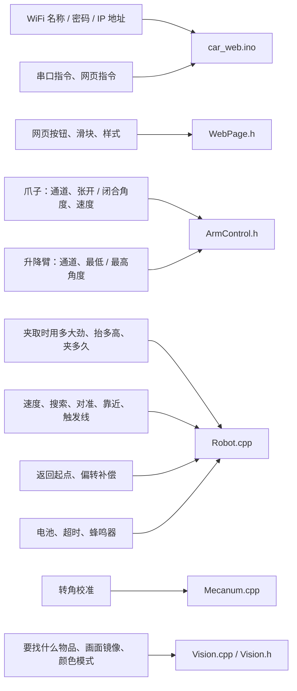

### 改完怎么验证（每次都要做）


- **涉及车轮的改动，先把车垫起来让轮子悬空**，用串口 `f 10`、`tl 30` 单独测，确认方向和距离对了再放到地上。
- **涉及舵机的改动，先用 `claw <度>`、`lift <度>` 一点一点试**（每次 5°），听到舵机"吱吱"响、一直在用力，就说明顶到头了，马上发 `release` 卸力。
- `ArmControl.h` 末尾有一组 `#error` 检查，角度写得前后矛盾（比如闭合角大于张开上限）时**编译会直接报错**，按报错提示改就行。

---

### 1. WiFi 热点：名称、密码、IP 地址

文件：`car_web/car_web.ino`

**改名称和密码**（第 16~17 行）：

```cpp
static constexpr char kApSsid[] = "miniAuto-JOY";   // 热点名称，手机 WiFi 列表里看到的名字
static constexpr char kApPassword[] = "miniauto88"; // 密码，至少 8 位；写成 "" 就是不要密码
```

**改 IP 地址**（比如把 `192.168.4.1` 改成 `192.168.10.1`）：

`192.168.4.1` 是 ESP32 开热点时的**默认地址**，代码里没有写这个数字，所以要改得自己加两行。第一步，在第 17 行密码下面加一个常量：

```cpp
static const IPAddress kApIp(192, 168, 10, 1);      // 想要的地址
```

第二步，在 `setup()` 里 `WiFi.softAP(...)` 那一行（第 93 行）**前面**加一行：

```cpp
  WiFi.mode(WIFI_AP);
  WiFi.softAPConfig(kApIp, kApIp, IPAddress(255, 255, 255, 0));  // 新增：小车地址、网关、子网掩码
  WiFi.softAP(kApSsid, kApPassword);
```

改完以后，手机浏览器要打开 `http://192.168.10.1`。**网页本身不用改**：`WebPage.h` 里的请求写的都是相对路径（`/cmd`、`/status`），换了地址照样能用。开机时串口也会打印新地址。

> 注意：IP 前三段建议用 `192.168.x`，第四段用 1。不要和家里路由器的网段一样（家里路由器常用 `192.168.1.x`、`192.168.0.x`），免得手机搞混。

#### 连上家里 WiFi 后，板子的 IP 怎么定

默认小车是**自己开热点**，所以地址固定是 `192.168.4.1`。如果改成**连家里的路由器**（手机和小车连同一个 WiFi），小车的地址就由路由器分配，每次开机可能不一样。下面分两种做法。

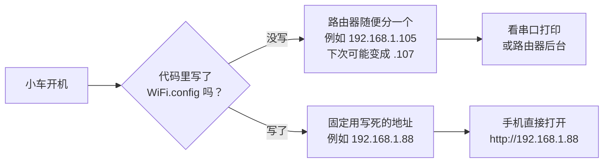

**做法一：让路由器分配，看串口打印的地址**（最简单）

把 `car_web.ino` 第 92~93 行的

```cpp
  WiFi.mode(WIFI_AP);
  WiFi.softAP(kApSsid, kApPassword);
```

换成

```cpp
  WiFi.mode(WIFI_STA);
  WiFi.begin("家里WiFi名", "家里WiFi密码");
  while (WiFi.status() != WL_CONNECTED) delay(500);
  Serial.println(WiFi.localIP());   // 路由器分给小车的地址，手机打开这个地址
```

开机后在串口里看打印出来的地址，比如 `192.168.1.105`，手机浏览器打开 `http://192.168.1.105`。也可以登录路由器管理页面，在"已连接设备"里找名字带 `esp32` 的设备。

**做法二：固定 IP**（推荐，每次开机地址都一样）

先查清楚家里网络的三个信息。手机连上家里 WiFi，在 WiFi 详情里能看到：

| 要查的 | 去哪看 | 例子 |
|---|---|---|
| 路由器地址（网关） | 手机 WiFi 详情里的"路由器"或"网关" | `192.168.1.1` |
| 子网掩码 | 同上 | `255.255.255.0` |
| 给小车用的地址 | **自己定**：前三段和路由器一样，最后一段选一个没人用的 | `192.168.1.88` |

然后把第 92~93 行换成下面这段（数字换成你家的）：

```cpp
  WiFi.mode(WIFI_STA);
  WiFi.config(IPAddress(192, 168, 1, 88),    // 小车固定用这个地址
              IPAddress(192, 168, 1, 1),     // 网关 = 路由器地址
              IPAddress(255, 255, 255, 0),   // 子网掩码
              IPAddress(192, 168, 1, 1));    // DNS，填路由器地址即可
  WiFi.begin("家里WiFi名", "家里WiFi密码");
  uint32_t wifiStart = millis();
  while (WiFi.status() != WL_CONNECTED && millis() - wifiStart < 15000) delay(500);
  if (WiFi.status() == WL_CONNECTED) {
    Serial.print("已连上 WiFi，打开 http://");
    Serial.println(WiFi.localIP());
  } else {
    Serial.println("连不上 WiFi，改开热点 miniAuto-JOY");
    WiFi.mode(WIFI_AP);
    WiFi.softAP(kApSsid, kApPassword);
  }
```

这段代码还带了一个**保底**：15 秒内连不上家里 WiFi（比如带去比赛现场），就自动改回开热点，手机照样能连 `miniAuto-JOY` 打开 `http://192.168.4.1`。改完后，原来下面几行打印热点信息的 `Serial.print(...)` 可以删掉，不删也不影响使用。

**注意事项：**

- **前三段必须和路由器一样。** 路由器是 `192.168.0.1`，小车就要用 `192.168.0.x`；写成 `192.168.1.88` 手机就打不开。
- **最后一段不要和别的设备撞号。** 建议选大一点的数，比如 `88`、`150`、`200`。路由器一般从小号开始往外分配，大号比较不容易撞。最稳的办法是在路由器后台把这个地址"保留 / 绑定"给小车。
- **这块 ESP32 只支持 2.4G WiFi**，连不上 5G（名字里带 `5G` 的一般都是）。双频路由器要连 2.4G 那个名字。
- WiFi 名和密码会写在代码里，**上传到 GitHub 之前记得改回占位文字**，别把家里密码公开出去。
- 比赛现场建议用热点模式，不依赖场地网络。

---

### 2. 手机网页

文件：`car_web/WebPage.h`（整个网页是一段写在 C++ 字符串里的 HTML）

**加一个按钮**，比如"只夹不回"（找到夹起后停在原地，不返回）。这个功能串口已经有了（`grab`），但网页上没有，需要改两处：

① `WebPage.h` 第 42 行，"开始寻物"按钮旁边加一个按钮：

```html
<div class="row"><button class="main" onclick="cmd('fetch')">开始寻物</button><button onclick="cmd('grab')">只夹不回</button></div>
```

② `car_web.ino` 的 `handleCmd()` 里（第 49 行附近），让网页也认这条指令：

```cpp
  if (c == "fetch") {
    cmd.type = CMD_FETCH;
  } else if (c == "grab") {        // 新增
    cmd.type = CMD_GRAB;            // 新增
  } else if (c == "return") {
```

**原则：网页按钮只负责发请求，真正干活的逻辑都在 `Robot.cpp` 里**。所以加按钮通常就是 `WebPage.h` 加按钮 + `car_web.ino` 认指令这两步。

**其他常改的地方：**

| 想改 | 位置 | 说明 |
|---|---|---|
| 定距按钮的距离选项 | 第 51 行 `<select id="cm">` | 选项不能超过 `car_web.ino` 里的 `kMaxStepCm`（50） |
| 转向角度选项 | 第 59 行 `<select id="deg">` | 不能超过 `kMaxTurnDeg`（180） |
| "爪子张开 / 合拢"按钮角度 | 第 65 行 `arm('claw',150)` / `arm('claw',100)` | 必须在爪子允许范围内（见第 3 节） |
| 爪子滑块范围 | 第 68 行 `min="90" max="160"` | **改了爪子角度限位，这里要一起改** |
| 升降滑块范围 | 第 71 行 `min="58" max="132"` | **改了升降角度限位，这里要一起改** |
| 状态刷新频率 | 第 94 行 `setInterval(poll,1000)` | 单位毫秒 |
| 颜色 | 第 10~11 行 `:root{...}` | 第二行是深色模式的颜色 |

网页的滑块范围只管手机上能拖到哪儿。超出范围的值发过来，`car_web.ino` 也会拒绝（"指令参数不正确"），**不会伤到舵机**。

---

### 3. 爪子（开合舵机）

主要文件：`car_web/ArmControl.h`（限位和通道），`car_web/Robot.cpp`（夹取时的用法）

**角度方向：数字越大，张得越开。** 90° = 完全闭合，160° = 张开上限。

| 想改 | 常量 | 文件:行 | 当前值 | 说明 |
|---|---|---|---:|---|
| 爪子插在驱动板哪个接口 | `ARM_CLAW_PWM_CHANNEL` | ArmControl.h:24 | 1 | 填板子上印的编号 1~4 |
| 张开上限 | `ARM_CLAW_MAX_ANGLE` | ArmControl.h:78 | 160 | 寻物时爪子张到这个角度；**不要设 180**，会顶到机械极限一直发热 |
| 完全闭合角度 | `ARM_CLAW_HOME_ANGLE` | ArmControl.h:82 | 90 | 整个程序里爪子**永远不会比这个更合**；`ARM_CLAW_CLOSED_ANGLE` 跟着它走 |
| 开机时的角度 | `ARM_DEFAULT_CLAW_ANGLE` | ArmControl.h:106 | 130 | 开机先停在中间，不吓到手 |
| 转动速度 | `ARM_CLAW_SMOOTH_SPEED_DPS` | ArmControl.h:132 | 220 | 每秒最多转多少度，越小越慢越稳 |
| 夹取时合到多少度 | `kGrabClawAngle` | Robot.cpp:51 | 90（= 闭合角） | 想夹松一点就改成 `ARM_CLAW_CLOSED_ANGLE + 5` |
| 多少度以下算"在夹东西" | `kHoldBelowAngle` | Robot.cpp:52 | 125 | 低于它开始计夹持时间 |
| 夹持超时 | `kMaxHoldMs` / `kMaxCarryHoldMs` | Robot.cpp:53~54 | 30 秒 / 90 秒 | 超时后**只松爪子**；后者是返回途中用的 |

**换了新爪子 / 新舵机后怎么重新定角度：**

1. 串口发 `release`，用手把爪子掰到大概中间；
2. 发 `claw 130`，然后每次减 5°（`claw 125`、`claw 120`……），直到两片爪子刚好合上。**听到舵机吱吱响就停**，往回加 5°。这个数就是新的 `ARM_CLAW_HOME_ANGLE`；
3. 同样往大加，找到张得最开、又不顶住的角度，再**少留 10° 余量**，作为 `ARM_CLAW_MAX_ANGLE`；
4. 改完 `ArmControl.h`，**别忘了把网页滑块（`WebPage.h` 第 68 行）和按钮（第 65 行）的范围一起改**；
5. 编译、烧录，用 `claw` 指令验证最小、最大两头。

> ⚠️ **舵机安全**：开发中曾经因为爪子一直顶着用力把舵机烧冒烟。请不要删掉 `setClaw()` 里的限位（Robot.cpp 第 288 行 `constrain(...)`），也不要把 `kMaxHoldMs` 调得很大，更不要加"定时重新给舵机上力"的代码。

**换接口：** 如果驱动板某个舵机接口坏了，把爪子插到别的口，然后改 `ARM_CLAW_PWM_CHANNEL`。爪子和升降臂不能用同一个编号。

---

### 4. 升降臂

文件：`car_web/ArmControl.h`（限位），`car_web/Robot.cpp`（搬运高度）

**角度方向：数字越小，臂放得越低。** 58° 贴地，132° 抬到最高。

| 想改 | 常量 | 文件:行 | 当前值 | 说明 |
|---|---|---|---:|---|
| 插在驱动板哪个接口 | `ARM_HEIGHT_PWM_CHANNEL` | ArmControl.h:18 | 2 | 原本说明书是升降 1、爪子 2；本车接口 2 疑似坏过，所以两个对调了 |
| 最低角度（夹取位置） | `ARM_HEIGHT_MIN_ANGLE` | ArmControl.h:44 | 58 | 夹取时臂放到这里，`ARM_HEIGHT_LOWER_ANGLE` 跟着它走 |
| 最高角度 | `ARM_HEIGHT_MAX_ANGLE` | ArmControl.h:48 | 132 | |
| 开机角度 | `ARM_DEFAULT_HEIGHT_ANGLE` | ArmControl.h:101 | = 最低 | |
| 升降速度 | `ARM_HEIGHT_SMOOTH_SPEED_DPS` | ArmControl.h:120 | 75 | 每秒最多转多少度 |
| 夹起后抬到多高 | `kCarryLiftAngle` | Robot.cpp:50 | 70 | **只抬一点**，贴地兜着走；抬太高舵机慢慢泄力，东西会掉 |

**重新定角度的方法**和爪子一样：先用 `lift <度>` 一点一点试，找到爪子刚好贴地、又不顶地面的角度作为 `ARM_HEIGHT_MIN_ANGLE`。改完同步改网页滑块（`WebPage.h` 第 71 行）。

**改了最低角度后，夹取的位置也会变**：臂放得更低或更高，爪子和物品接触的高度就变了，可能需要重新调第 7 节的冲刺距离 `kFinalFromTriggerCm`。

---

### 5. 底盘运动

文件：`car_web/Robot.cpp`（速度、尺寸），`car_web/Mecanum.cpp`（转角校准）

| 想改 | 常量 | 文件:行 | 当前值 | 说明 |
|---|---|---|---:|---|
| 车轮尺寸 | `kAxleWidthM` / `kAxleLengthM` / `kWheelDiameterM` | Robot.cpp:9~11 | 0.140 / 0.145 / 0.065 米 | 换了底盘才需要改 |
| 定距直线速度 | `kStepSpeedMps` | Robot.cpp:14 | 0.10 m/s | 调快了刹车距离变长，距离会不准 |
| 原地转速度 | `kTurnSpeedRadS` | Robot.cpp:15 | 1.0 rad/s | |
| 对准时的慢转速度 | `kAlignTurnSpeedRadS` | Robot.cpp:49 | 0.4 rad/s | |
| 最后冲刺速度 | `kFinalSpeedMps` | Robot.cpp:41 | 0.06 m/s | 慢一点，碰到物品冲击小 |
| 摇杆最高速度 | `kJoyMaxSpeedMps` / `kJoyMaxTurnRadS` | Robot.cpp:16~17 | 0.12 m/s / 1.0 rad/s | |
| 单次运动超时 | `kMotionTimeoutMs` | Robot.cpp:19 | 8000 ms | **调慢速度后要检查**：最长一段距离 ÷ 速度不能超过它 |
| 网页 / 串口单次最大距离、角度 | `kMaxStepCm` / `kMaxTurnDeg` | car_web.ino:18~19 | 50 cm / 180° | |

**转角不准怎么校准**（`Mecanum.cpp` 第 14 行 `kRotationDistanceScale`）：

1. 地上贴一条胶带当基准线，车头对齐；
2. 串口发 `tl 180`，量车实际转了多少度，比如 190°；
3. 把系数改成 `180.0f / 190.0f`（指令角度 ÷ 实际角度）。

**走直线车头偏怎么补**（`Robot.cpp` 第 73 行 `kYawDriftRadPerCm`，只影响返回起点）：

1. 车头对齐胶带，串口发 `f 30`；
2. 量车头偏了多少度，比如 4.5°；
3. 系数 = 偏的角度 × 0.01745 ÷ 走的厘米数 = 4.5 × 0.01745 ÷ 30 ≈ `0.0026f`。

---

### 6. 视觉：找什么、怎么挑

文件：`car_web/Vision.cpp`、`car_web/Vision.h`

**增加 / 删除要找的物品**（`Vision.cpp` 第 18 行）：

```cpp
static constexpr uint8_t kGraspableClassIds[] = {10, 12, 14, 29, 32, 39, 41, 46, 47, 49, 51, 54, 75, 77};
```

数字是 COCO 数据集的类别编号。常用的几个：

| 编号 | 物品 | 编号 | 物品 | 编号 | 物品 |
|---:|---|---:|---|---:|---|
| 32 | 运动球 | 39 | 瓶子 | 41 | 杯子 |
| 46 | 香蕉 | 47 | 苹果 | 49 | 橙子 |
| 64 | 鼠标 | 65 | 遥控器 | 67 | 手机 |
| 73 | 书 | 76 | 剪刀 | 77 | 玩具熊 |

（完整 80 类可以搜 "COCO 80 classes"，编号从 0 开始。）

**怎么知道你的物品被认成了什么：** 把物品放在车前 30~50 cm，串口发 `look`，会打印画面里所有识别到的东西，比如 `[类别41* 中心X=284 框=42x42 下边Y=153]`。带 `*` 的是已经在清单里的；不带 `*` 的，把它的编号加进清单就行。**很多物品会被认成奇怪的类别**（本车实测：小瓶子被认成"花瓶""停车收费表"，比赛物品被认成"鸟"），以 `look` 打印的为准。

**加了新编号后，顺便加个中文名**（`Vision.cpp` 第 209 行起的 `visionClassName()`），串口日志和网页提示里就会显示中文：

```cpp
    case 64: return "鼠标";
```

**其他视觉设置：**

| 想改 | 常量 | 文件:行 | 说明 |
|---|---|---|---|
| 画面是否左右镜像 | `kImageMirrored` | Vision.h:11 | 物品在车左边、画面里却在右边，就是 `true`。设错了，"先夹最右边"会变成"先夹最左边" |
| 改用颜色识别 | `kVisionUseColor` | Vision.h:9 | 改成 `true`，**P4 模块要换烧官方颜色识别固件**，画面变成 240×240 |
| 颜色模式找什么颜色 | `s_colorTargets` | Vision.cpp:9 | 0 红、1 蓝、2 绿；也可以串口 `color 0` 临时切换 |
| 多个物品先夹哪个 | `considerBox()` 里的 `score` | Vision.cpp:113~114 | 现在是"车实际最右边"优先；想改成"最近的优先"，把第 114 行的 `(kImageMirrored ? -cx : cx)` 换成 `(float)(y + h)`（底边越低越近） |

---

### 7. 寻物策略：搜索、对准、靠近、夹取

文件：`car_web/Robot.cpp` 第 25~82 行，全部是可调参数，每个都有中文注释。

**搜索**

| 常量 | 行 | 当前值 | 调大 / 调小的效果 |
|---|---:|---:|---|
| `kInitialLookMs` | 68 | 4000 ms | 开始时原地先看多久 |
| `kSearchStepRad` | 32 | 0.52 rad（30°） | 每次转多少；转太多可能把目标转过去 |
| `kSearchSteps` | 33 | 12 | 转几次算一圈；和上一个相乘应约等于 360° |
| `kSearchDwellMs` | 72 | 2500 ms | 每个方向停多久；远处小目标漏检多就调大 |
| `kConfirmLookMs` | 71 | 2000 ms | 第一次看到后再确认多久 |
| `kMaxRelocations` | 34 | 5 | 一圈没找到，最多换几次位置 |

**对准和靠近**

| 常量 | 行 | 当前值 | 说明 |
|---|---:|---:|---|
| `kCenterDeadbandPx` | 27 | 12 px | 偏差在这以内才开始往前走；老是左右来回摆就调大 |
| `kDriftCorrectPx` | 28 | 15 px | 走的途中偏差超过它才停下来纠正 |
| `kFinalAlignPx` | 29 | 10 px | 最后冲刺前必须对正到多少 |
| `kFarBottomY` / `kNearBottomY` | 42~43 | 150 / 185 | 决定"远 / 中 / 近"的分界线 |
| `kMaxStepCm` / `kMidStepCm` / `kFineStepCm` | 37 / 44~45 | 10 / 5 / 3 cm | 远、中、近各走多少一步 |

**夹取（最常调的两个）**

| 常量 | 行 | 当前值 | 怎么调 |
|---|---:|---:|---|
| `kTriggerBottomY` | 39 | 210 | 触发线。**摄像头角度动过就要重新标定** |
| `kFinalFromTriggerCm` | 40 | 18 cm | 过线后再走多远合爪。**撞倒 / 推走物品 → 减小；夹空、爪子没碰到 → 加大**，每次改 1 cm |

**标定冲刺距离的方法：** 物品放在车前约 50 cm 处，串口发 `grab`（只夹不回），看合爪那一下：

- 物品被推倒或推走 → `kFinalFromTriggerCm` 减 1；
- 爪子合上时物品还在爪子前面、没进到中间 → 加 1；
- 爪子刚好碰到物品，物品在两片爪子正中 → 就是它了。本车实测：19 cm 会撞倒，17 cm 稍远，**18 cm 刚好**。

**夹后自检**

| 常量 | 行 | 当前值 | 说明 |
|---|---:|---:|---|
| `kMaxGrabRetries` | 55 | 2 | 没夹住最多重试几次 |
| `kVerifyBackoffM` | 56 | 0.10 m | 夹完后退多远再检查 |
| `kMissBottomYPx` | 57 | 170 | 后退后物品底边还在这条线以下 = 还躺在地上 |
| `kSameTargetPx` | 78 | 40 px | 离原来位置多近才算"同一个物品" |

物品比较高、夹在爪子里还露在画面中、被误判"没夹住"的时候，可以先用串口 `check off` 关掉自检试试。

---

### 8. 返回起点

文件：`car_web/Robot.cpp`

| 想改 | 位置 | 说明 |
|---|---|---|
| 回到起点后做什么 | 第 661 行 `setArm(ARM_HEIGHT_LOWER_ANGLE, ARM_CLAW_OPEN_ANGLE);` | 现在是"放低、张开爪子"把东西放下。想**带回来不放下**，就把这一行删掉；但要注意夹持超时（`kMaxHoldMs`）后爪子还是会自动松开 |
| 回程每段最多走多远 / 转多少 | 第 79~80 行 `kReturnChunkM` / `kReturnChunkRad` | 0.30 m / 90°；**调大时注意不能超过运动超时** |
| 路线最多记多少段 | 第 84 行 `kMaxPathSteps` | 128 |
| 回程偏转补偿 | 第 73 行 `kYawDriftRadPerCm` | 见第 5 节的标定方法；设成 `0.0f` 就是不补偿 |

---

### 9. 电池、超时、蜂鸣器

文件：`car_web/Robot.cpp`

| 想改 | 常量 | 行 | 当前值 |
|---|---|---:|---:|
| 低电压保护 | `kMinBatteryMv` | 22 | 6800 mV（低于 6.8 V 拒绝动作） |
| 摇杆断线自动停车 | `kJoyTimeoutMs` | 18 | 400 ms |
| 运动超时 | `kMotionTimeoutMs` | 19 | 8000 ms |
| 蜂鸣器开关 | `kBuzzerEnabled` | 67 | `false`（关）。改成 `true` 后，成功响 1 声、失败响 3 声 |

---

### 10. 加一条串口指令

文件：`car_web/car_web.ino`

- **马上生效、不排队的指令**（比如查询、开关某个功能）：加在 `handleImmediateSerial()` 里（第 111 行起），照着 `check` 那段写；
- **要让车动的指令**：加在 `handleSerialLine()` 里（第 135 行起），照着 `grab` 那段写，设置 `cmd.type`，然后在 `Robot.h` 的 `CommandType` 里加一个新类型，在 `Robot.cpp` 的 `execute()` 里加一个 `case` 去执行。

所有会动硬件的事情**都必须在 `Robot.cpp` 的动作线程里做**。不要在 `car_web.ino` 里直接调用电机、舵机函数，否则两个线程同时用 I2C 总线会出错（见[软件架构](#软件架构两个线程分工)）。

---

### 常见需求速查

| 我想…… | 改这里 |
|---|---|
| 把 192.168.4.1 改成别的地址 | 第 1 节：`car_web.ino` 加 `softAPConfig` |
| 连家里 WiFi，并让小车 IP 固定不变 | 第 1 节"连上家里 WiFi 后，板子的 IP 怎么定"：`WiFi.config` |
| 改热点名字 / 密码 | `car_web.ino` 第 16~17 行 |
| 夹子夹不紧，东西会掉 | 先检查 `kGrabClawAngle` 是否已经是闭合角 90；再把 `kCarryLiftAngle` 调低一点（贴地兜着） |
| 夹子张不够大，物品进不去 | `ARM_CLAW_MAX_ANGLE` 调大（每次 5°，别顶住），同步改网页滑块 |
| 升降臂放下时爪子离地太高 / 顶地 | `ARM_HEIGHT_MIN_ANGLE` 调小 / 调大，同步改网页滑块 |
| 合爪时撞倒物品 / 夹空 | `kFinalFromTriggerCm` 减小 / 加大，每次 1 cm |
| 换一种要找的物品 | `look` 看编号 → 加进 `kGraspableClassIds` → `visionClassName()` 加中文名 |
| 找东西太慢 | `kSearchDwellMs` 调小（但远处目标更容易漏） |
| 对准时左右来回摆 | `kCenterDeadbandPx` 调大，或 `kAlignTurnSpeedRadS` 调小 |
| 回到起点车头歪了 | 重新标定 `kYawDriftRadPerCm`（第 5 节） |
| 回到起点不要放下东西 | 删 `Robot.cpp` 第 661 行 |
| 打开蜂鸣器 | `kBuzzerEnabled = true` |

---

## 参数调优表

换了场地、换了物品，主要调这些（都在 `car_web/Robot.cpp` 开头）：

| 参数 | 当前值 | 含义 | 什么时候调 |
|---|---|---|---|
| `kTriggerBottomY` | 210 | 触发线 Y 坐标 | 摄像头角度变了 |
| `kFinalFromTriggerCm` | 18 cm | 过线后再走多远合爪 | 爪子夹空（太短）或把东西推走（太长） |
| `kCenterDeadbandPx` | 12 px | 对准门槛 | 老是左右摆（调大）或对不正（调小） |
| `kSearchDwellMs` | 2500 ms | 搜索时每个方向停多久 | 远处目标经常漏掉 |
| `kYawDriftRadPerCm` | 0.0026 | 走直线的偏转率 | 回到起点时车头歪了 |
| `kCarryLiftAngle` | 70° | 搬运时升降臂角度 | 路上掉东西 |
| `kMaxHoldMs` | 30 s | 夹持超时 | 一般不要调大 |
| `kGraspableClassIds` | 14 类 | 可夹取清单（在 `Vision.cpp`） | 换了要找的物品 |

---

## 实测踩过的坑

这些都是在实车上一次次试出来的，代码注释里也都留了记录：

| 现象 | 原因 | 解决 |
|---|---|---|
| 舵机冒烟 | 绕过了防堵转保护，爪子一直顶着用力 | 角度限位 + 夹持超时自动卸力 + 随时可卸力 |
| 夹起来走两步就掉 | 官方夹取角度 102° 偏松；抬太高舵机会泄力 | 合到 90°，只抬到 70° |
| 车左边的东西出现在画面右边 | 摄像头画面左右镜像 | `kImageMirrored = true` |
| 转完去读，结果几乎没变 | 读到的是动作前缓存的旧画面 | 动完等 0.7 秒、丢第一帧、比较前后结果 |
| 一步跨过触发线，冲过头撞上 | 远处步子太大 | 越近步子越小：10 / 5 / 3 cm |
| 横移靠近每次都往右偏 | 麦轮在地毯上横移会带着车头转 | 只用原地转 + 直线走 |
| 小角度转向转过头 | 慢速小角度时电机冲过头，实际转 1.5~2 倍 | 每次只转偏差的一半 |
| 回到起点时车头歪了 | 走直线时车头顺时针慢慢偏 | 回程按距离估算偏转并补回来 |
| 底边突然变小，又多走 10 cm | YOLO 偶尔只认出物体上半截 | 底边取到过的最大值 |
| 近处瓶子时有时无 | 近处识别一半帧漏检 | 多盯一会儿；进了盲区直接冲刺 |
| 物体被认成"鸟""花瓶""收费表" | YOLO 训练数据里没有类似物品 | 把这些常见误认类别也加进清单 |
| 返回长路段半路停下 | 合并后 90 cm 一次走要 9 秒，超过运动超时 | 回程拆成每块最多 30 cm / 90° |
| 小蓝球用颜色识别认不出 | 官方颜色阈值不适合这个球 | 改用 YOLO（颜色模式仍保留，`kVisionUseColor` 切换） |

---

## 目录结构

```
.
├── car_web/            ★ 最终版主程序（网页 + 寻物 + 返回），比赛用的就是它
├── find_fetch/         早期版本：上电自动寻物，没有网页
├── car_vision_test/    测试：小车不动，打印 YOLO 识别结果和超声波距离
├── car_align_test/     测试：只原地转向对准目标，验证转向方向和角度换算
├── car_move_test/      测试：前进 2 cm、后退 2 cm，验证电机方向
├── car_joystick/       测试：只有网页摇杆
├── car_claw_test/      测试：升降臂抬起放下
├── car_calibrate/      工具：4 路编码电机自动校准
├── car_probe/          工具：探测驱动板校准寄存器
└── docs/images/        README 用图
```

Arduino 要求草图文件夹名和 `.ino` 文件名一致，所以每个测试都是独立的文件夹，可以单独打开烧录。项目的开发过程也就是这些文件夹的顺序：

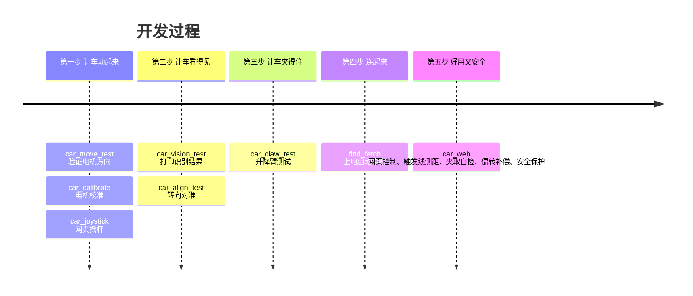

---

## 致谢与说明

- 硬件和底层驱动（`BoardDriver`、`WonderLLM`、`Ultrasound`、`Mecanum`、`ArmControl` 的原始版本）来自**幻尔科技 miniAuto Pro** 官方例程，版权归原作者所有。
- 视觉模块固件 `WonderLLM_P4_Yolo11nDetect` 来自幻尔官方，本仓库不包含。
- 识别模型 YOLO11n 来自 Ultralytics，使用 COCO 数据集的 80 个类别。
